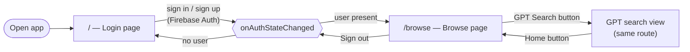
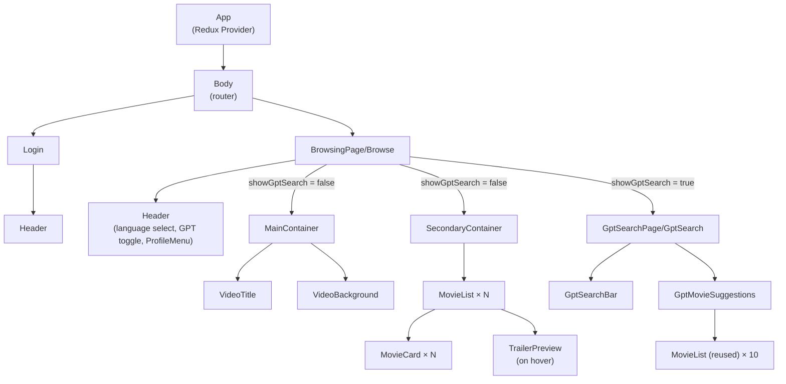
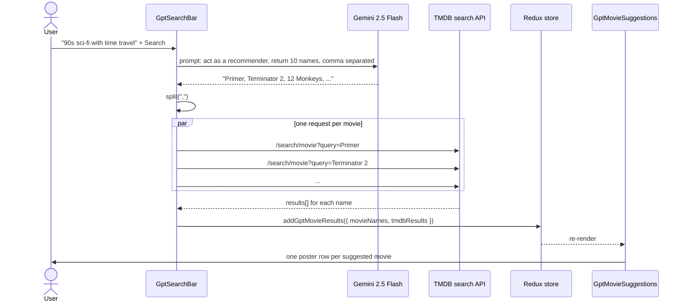

# MovieFlix GPT

A Netflix-style movie browsing app with an **AI movie recommender**. Users sign up and sign in with **Firebase
Authentication**, browse real movie catalogues from **TMDB** with an auto-playing trailer hero banner and hover
trailer previews, and ask **Google Gemini** for recommendations in plain language ("funny feel-good Hindi movies
from the 2000s") — in English, Hindi, Spanish, Marathi or Konkani. Gemini's suggestions are then looked up on TMDB and
shown as posters.

Built with **React 19**, **Redux Toolkit**, **React Router 7** and **Tailwind CSS**, and deployable to **Firebase
Hosting**.

> For a file-by-file explanation of the code, read **[docs/CODE_WALKTHROUGH.md](docs/CODE_WALKTHROUGH.md)**.

---

## Table of contents

1. [Features](#features)
2. [Tech stack](#tech-stack)
3. [How it works](#how-it-works)
4. [State management (Redux store)](#state-management-redux-store)
5. [External APIs](#external-apis)
6. [Getting started](#getting-started)
7. [Environment variables](#environment-variables)
8. [Deploying to Firebase Hosting](#deploying-to-firebase-hosting)
9. [Project structure](#project-structure)
10. [Performance and good practices used](#performance-and-good-practices-used)
11. [Known limitations and next steps](#known-limitations-and-next-steps)

---

## Features

### Authentication
- **Sign up / sign in** with email and password through Firebase Authentication (one form that toggles between
  modes).
- **Client-side validation** before calling Firebase: valid email; password of 8+ characters with an uppercase
  letter, a lowercase letter and a digit.
- On sign-up the user's **display name and avatar** are saved to their Firebase profile.
- A single **auth listener** (`onAuthStateChanged`) keeps Redux in sync and redirects: signed-in users go to
  `/browse`, signed-out users back to `/`. The listener is unsubscribed when the header unmounts.
- **Profile menu** with the user's name and avatar and a **Sign out** action.

### Browse page
- **Hero banner** — the first "Now Playing" movie with its title and overview over a **muted, auto-playing, looping
  YouTube trailer**.
- **Movie rows** — Now Playing, Trending (top rated), Popular and Upcoming, as horizontally scrolling poster rows
  with hidden scrollbars.
- **Hover trailer preview** — hovering a poster opens a floating mini-player above it with that movie's trailer.
- **Trailer cache** — each movie's trailer is fetched once and stored in Redux by movie id.
- **Memoised fetching** — each list is fetched only if it is not already in the store.

### GPT search
- A **"GPT Search" / "Home"** toggle in the header switches between browsing and AI search.
- The user describes what they want; the app asks **Gemini 2.5 Flash** for exactly 10 movie names.
- Each name is searched on TMDB **in parallel** (`Promise.all`) and every result is shown as its own poster row.
- **Multi-language UI** — the search placeholder and button are translated into **English, Hindi, Spanish, Marathi
  and Konkani** through a language dropdown that appears in search mode.

---

## Tech stack

| Concern | Technology |
|---|---|
| UI library | React 19 (Create React App / `react-scripts` 5) |
| Routing | React Router 7 (`createBrowserRouter`, `RouterProvider`, `useNavigate`) |
| State | Redux Toolkit 2 (`configureStore`, `createSlice`) + React-Redux 9 |
| Styling | Tailwind CSS 3 + `tailwind-scrollbar-hide` plugin |
| Auth | Firebase Authentication (email/password) + Firebase Analytics |
| Movie data | TMDB (The Movie Database) REST API v3 and image CDN |
| AI | Google Gemini via `@google/genai` (model `gemini-2.5-flash`) |
| Video | YouTube embedded player |
| Icons | `lucide-react` |
| Hosting | Firebase Hosting |

---

## How it works

### Page flow



### Component tree



### GPT search sequence



---

## State management (Redux store)

`src/utils/appStore.js` combines four slices:

| Slice | State | Actions | Used by |
|---|---|---|---|
| `user` | `null` or `{ uid, email, displayName, photoURL }` | `addUser`, `removeUser` | Login, auth listener, Header |
| `movies` | `nowPlayingMovies`, `popularMovies`, `topRatedMovies`, `upcomingMovies` (TMDB responses), `trailerVideos` (`{ [movieId]: video }`) | `addNowPlayingMovies`, `addPopularMovies`, `addTopRatedMovies`, `addUpcomingMovies`, `addTrailerVideos`, `removeMovie` | fetch hooks, containers, trailer components |
| `gpt` | `showGptSearch`, `gptMovieNames`, `gptMovieResults` | `toggleGptSearchView`, `addGptMovieResults` | Header, Browse, GPT search components |
| `config` | `lang` (default `'en'`) | `changeLanguage` | Header language select, GptSearchBar |

---

## External APIs

| API | Endpoint(s) | Purpose |
|---|---|---|
| TMDB | `/3/movie/now_playing`, `/popular`, `/top_rated`, `/upcoming` | Movie rows |
| TMDB | `/3/movie/{id}/videos` | Trailer for hero banner and hover preview |
| TMDB | `/3/search/movie?query=…` | Turn Gemini's names into real movies |
| TMDB image CDN | `https://image.tmdb.org/t/p/w780/{poster_path}` | Poster images |
| Google Gemini | `models.generateContent` with `gemini-2.5-flash` | Movie recommendations |
| Firebase Auth | `createUserWithEmailAndPassword`, `signInWithEmailAndPassword`, `updateProfile`, `onAuthStateChanged`, `signOut` | Accounts and sessions |
| YouTube | `https://www.youtube.com/embed/{key}` | Playing trailers |

---

## Getting started

### Prerequisites

- Node.js 18+ and npm
- A **TMDB** account → API Read Access Token (v4 "Bearer" token) from <https://www.themoviedb.org/settings/api>
- A **Gemini** API key from <https://aistudio.google.com/app/apikey>
- A **Firebase** project with **Email/Password** sign-in enabled (Authentication → Sign-in method)

### Install and run

```bash
git clone https://github.com/sahilshirodkar1630/movieflix-gpt.git
cd movieflix-gpt
npm install
# create .env (see below)
npm start
```

The app runs on <http://localhost:3000>.

If you use your own Firebase project, replace the `firebaseConfig` object in `src/utils/firebase.js` with the one
from *Firebase console → Project settings → Your apps → Web app*.

### Other scripts

| Command | What it does |
|---|---|
| `npm run build` | Production build into `build/` |
| `npm test` | Runs Jest in watch mode (React Testing Library is installed) |

---

## Environment variables

Create a file named `.env` in the project root (it is already in `.gitignore`):

```env
REACT_APP_TMDB_API_KEY=your_tmdb_read_access_token
REACT_APP_GEMINI_API_KEY=your_gemini_api_key
```

Create React App only exposes variables that start with `REACT_APP_`, and reads them **at build time** — restart
`npm start` after changing `.env`.

> These values are bundled into the JavaScript that runs in the browser, so anyone can see them in DevTools. That is
> acceptable for a demo; for production, call TMDB and Gemini from a small backend (e.g. a Firebase Cloud Function)
> and keep the keys there.

---

## Deploying to Firebase Hosting

`firebase.json` serves the `build/` folder. Deploy with:

```bash
npm install -g firebase-tools
firebase login
firebase use --add            # pick your Firebase project (updates .firebaserc)
npm run build
firebase deploy --only hosting
```

Because the app uses client-side routing, add a rewrite so refreshing `/browse` does not return 404:

```json
{
  "hosting": {
    "public": "build",
    "ignore": ["firebase.json", "**/.*", "**/node_modules/**"],
    "rewrites": [{ "source": "**", "destination": "/index.html" }]
  }
}
```

---

## Project structure

```
src/
├── index.js                     React entry point (renders <App/>)
├── App.js                       Wraps everything in the Redux <Provider>
├── index.css                    Tailwind directives
├── components/
│   ├── Body.js                  Router: "/" → Login, "/browse" → Browse
│   ├── Login.js                 Sign-in / sign-up form + Firebase calls
│   ├── Header.js                Logo, language select, GPT toggle, profile menu; starts the auth listener
│   ├── ProfileMenu.js           Avatar dropdown with name and sign-out
│   ├── BrowsingPage/            ← the browse UI in use
│   │   ├── Browse.js            Fetches the four lists; shows browse or GPT view
│   │   ├── MainContainer.js     Hero: first "now playing" movie
│   │   ├── VideoTitle.js        Title, overview, Play / More Info buttons
│   │   ├── VideoBackground.js   Full-screen muted looping YouTube trailer
│   │   ├── SecondaryContainer.js  The movie rows
│   │   ├── MovieList.js         One titled, horizontally scrolling row
│   │   ├── MovieCard.js         One poster; reports hover position
│   │   └── TrailerPreview.js    Floating trailer above the hovered poster
│   ├── GptSearchPage/           ← the AI search UI in use
│   │   ├── GptSearch.js         Background + search bar + suggestions
│   │   ├── GptSearchBar.js      Prompt → Gemini → TMDB → Redux
│   │   └── GptMovieSuggestions.js  One MovieList per suggested movie
│   └── (Browse.js, MainContainer.js, MovieList.js, … at this level are older copies — not imported)
├── hooks/
│   ├── useAuthListener.js       Firebase onAuthStateChanged → Redux + redirect
│   ├── useNowPlayingMovies.js   ┐
│   ├── usePopularMovies.js      │ fetch a TMDB list once and store it
│   ├── useTopRatedMovies.js     │
│   ├── useUpcomingMovies.js     ┘
│   └── useMovieTrailer.js       Fetch + cache one movie's trailer
└── utils/
    ├── appStore.js              Redux store
    ├── userSlice.js / moviesSlice.js / gptSlice.js / configSlice.js
    ├── constants.js             URLs, TMDB request options, languages, env keys
    ├── languageConstants.js     Translations for the search UI
    ├── validate.js              Email/password validation
    ├── firebase.js              Firebase app + auth
    └── gemini.js                Gemini client
```

---

## Performance and good practices used

- **Custom hooks** keep data fetching out of components (`useNowPlayingMovies`, `useMovieTrailer`, …).
- **Fetch once (memoisation)** — list hooks skip the request if the data is already in Redux; trailers are cached
  per movie id, so hovering the same poster twice does not refetch.
- **Parallel requests** for GPT results with `Promise.all`.
- **Component reuse** — the same `MovieList` renders browse rows and AI results.
- **Uncontrolled inputs with `useRef`** for the forms (no re-render on every keystroke).
- **Single auth listener with cleanup** — `onAuthStateChanged` returns an unsubscribe function, called on unmount.
- **Secrets outside the code** — TMDB and Gemini keys come from `.env`.
- **Responsive Tailwind classes** (`md:` breakpoints) for mobile and desktop layouts.

---

## Known limitations and next steps

- **API keys in the browser** — move TMDB and Gemini calls behind a backend/Cloud Function.
- **Gemini error handling** — if Gemini returns nothing or fails, the search throws; add a `try/catch` and an error
  message, and a loading spinner while waiting.
- **Language only affects the UI** — the selected language is not yet passed to Gemini or TMDB.
- **Duplicate rows** — `SecondaryContainer` renders "Now Playing" three times; replace two with new categories.
- **Unused legacy components** — the copies directly under `src/components/` (Browse, MainContainer, MovieList, …)
  can be deleted.
- **Route protection** relies on the auth listener redirect; a `<ProtectedRoute>` wrapper would avoid briefly
  rendering `/browse` for signed-out users.
- **Firebase project ids** — `.firebaserc` and `src/utils/firebase.js` point at different Firebase projects; use the
  same project in both.
- **Tests** — add React Testing Library tests for `validate.js`, the slices and the login form.
- **"Play" and "More Info"** buttons are visual only.
